# NDSES Website Guide

This guide is for NDS Environmental Solutions staff who will manage the website's content day to day. Everything you edit lives in **WordPress** — a standard, familiar admin dashboard, not code. You don't need to know how to program anything in this guide.

If a question isn't answered here, see [Who to Contact](#who-to-contact) at the bottom.

## Contents

- [Logging In](#logging-in)
- [How Editing Works](#how-editing-works)
- [Self-Check Checklist](#self-check-checklist)
- [Site Settings — Your Company Info](#site-settings--your-company-info)
- [Editing Page Content](#editing-page-content)
- [Managing Communities (Residential Service Areas)](#managing-communities-residential-service-areas)
- [Managing Dumpster Sizes](#managing-dumpster-sizes)
- [Managing Commercial Containers](#managing-commercial-containers)
- [Managing FAQs](#managing-faqs)
- [Managing Service Areas & Schedules (the coverage map)](#managing-service-areas--schedules-the-coverage-map)
- [Posting Alerts & Notices](#posting-alerts--notices)
- [Viewing Contact Form Submissions](#viewing-contact-form-submissions)
- [Accepting Payments (PayEngine)](#accepting-payments-payengine)
- [Common Questions](#common-questions)
- [Who to Contact](#who-to-contact)

---

## Logging In

Go to `https://ndses.flywheelsites.com/wp-admin` and sign in with the account your developer set up for you. If you don't have a login yet, or you're locked out, contact your developer — see [Who to Contact](#who-to-contact).

Once logged in, everything below is reached from the black menu on the left side of the screen.

## How Editing Works

Every piece of content on the site — page text, service descriptions, FAQs, dumpster sizes, alerts — is edited using **ACF (Advanced Custom Fields)**. In practice this just means: open the item you want to change, you'll see a form with clearly labeled boxes (text fields, image pickers, on/off switches, dropdowns), fill them in, and click **Publish** or **Update** in the top-right corner. Nothing is saved until you click that button.

A few things that are true everywhere:

- **Nothing goes live until you click Publish/Update.** You can leave a page half-edited and come back later — WordPress keeps it as a draft.
- **Changes appear on the live site within a few minutes**, not instantly. If you don't see your change right away, wait 5 minutes and refresh. (See [Common Questions](#common-questions) if it still hasn't shown up.)
- **Required fields are marked** and the Publish button will tell you if something's missing.

**Where the edit boxes are.** The main site pages (Home, Residential, Commercial, Dumpster Rentals, Dumpster Calculator, Special Events, About, Make a Payment, Contact) open as a simple form: **Page Hero & SEO** at the top, then **[Page name] Page Sections** with one tab per section. On other screens (Dumpster Sizes, FAQs, Communities, Privacy Policy, Terms, and so on) WordPress shows its page editor first, and the editable boxes sit in the **Meta Boxes** panel at the bottom of the screen. Drag the small grey bar at the top of that panel upward to give it more room, or scroll inside it. The **Update** or **Save** button (or **Publish**, for a brand-new entry) is the blue button at the top right. Site Settings is a plain form with a **Save Settings** button at the bottom.

**After every change:** wait about 5 minutes, then open the page on the live site and hard-refresh (Cmd+Shift+R on Mac, Ctrl+Shift+R on Windows) to see it.

## Self-Check Checklist

Use this to confirm the site is set up correctly and everything is working, without needing to ask your developer. It's organized to match the sections below — if a step doesn't make sense, click through to that section for details. Nothing here requires technical knowledge; it's all things you can see and click yourself.

**Access**
- [ ] I can log in at `https://ndses.flywheelsites.com/wp-admin`
- [ ] I can see the full black admin menu on the left (Pages, Communities, Dumpster Sizes, Commercial Containers, FAQs, Service Notices, Service Areas, Form Submissions, Site Settings)

**Company info** — [Site Settings](#site-settings--your-company-info)
- [ ] Phone number is correct
- [ ] Email address is correct (this is also where form submissions get emailed — see below)
- [ ] Facility address and mailing address are both correct
- [ ] Office hours are accurate
- [ ] Facebook URL and Instagram URL point to your real pages (not left blank or placeholder)
- [ ] Header logo and footer logo both look right
- [ ] Footer description and copyright text read correctly
- [ ] Mission Statement and About Page: Our Story read correctly

**Page content** — [Editing Page Content](#editing-page-content)
- [ ] Home, About, Contact, Commercial, and Dumpster Rentals pages all have a heading, description, and image in their Hero

**Communities, sizes, containers, FAQs**
- [ ] Every [Community](#managing-communities-residential-service-areas) you serve has the correct service day, trash schedule, and recycling schedule
- [ ] Every [Dumpster Size](#managing-dumpster-sizes) you offer is listed with correct capacity, dimensions, Ideal For list, and image
- [ ] Every [Commercial Container](#managing-commercial-containers) you offer is listed with correct dimensions, capacity, and image
- [ ] [FAQs](#managing-faqs) cover the real questions customers ask, sorted into the right category (Dumpster, Residential, Commercial)

**Coverage map & schedule** — [Service Areas & Schedules](#managing-service-areas--schedules-the-coverage-map)
- [ ] Every town/county you service has a Service Area entry with the right Service Types checked
- [ ] The map on the Home/About/Commercial pages shows a dot in roughly the right place for each area

**Payments** — [Accepting Payments](#accepting-payments-payengine)
- [ ] I know where the Make a Payment page is, and I have NOT touched the PayEngine Secret Key field
- [ ] I've asked my developer to confirm whether the payment page is in test mode or live mode before real customers use it

**Contact form** — [Viewing Contact Form Submissions](#viewing-contact-form-submissions)
- [ ] I submitted a test entry through the Contact page myself
- [ ] I received the notification email for it
- [ ] I can see it listed under Form Submissions, and clicking it shows the full message

**Alerts** — [Posting Alerts & Notices](#posting-alerts--notices)
- [ ] I created one test Service Notice, saw it appear on the site, then set it to Resolved (or deleted it) to confirm I know the full cycle

Once every box is checked, the content side of the site is in your hands — you shouldn't need a developer for day-to-day updates.

## Site Settings — Your Company Info

**Menu: Site Settings**

This is the one screen that controls information shown across the *entire* site — footer, contact page, schema data search engines read, etc. Update it here once and it updates everywhere.

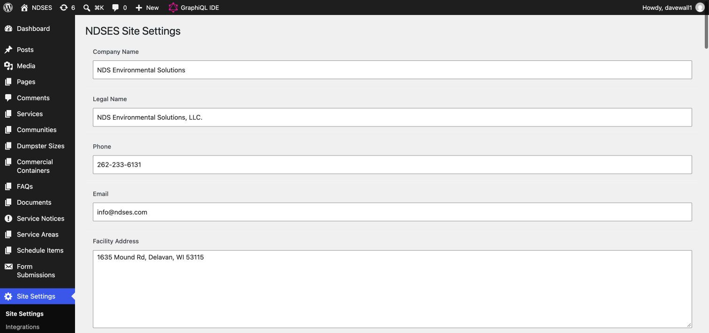

**How to update your phone, email, address, or hours**
1. In the left menu, click **Site Settings**.
2. Change the box you need. For **Office Hours**, put each line on its own row (press Enter between lines).
3. Scroll to the bottom and click **Save Settings**.

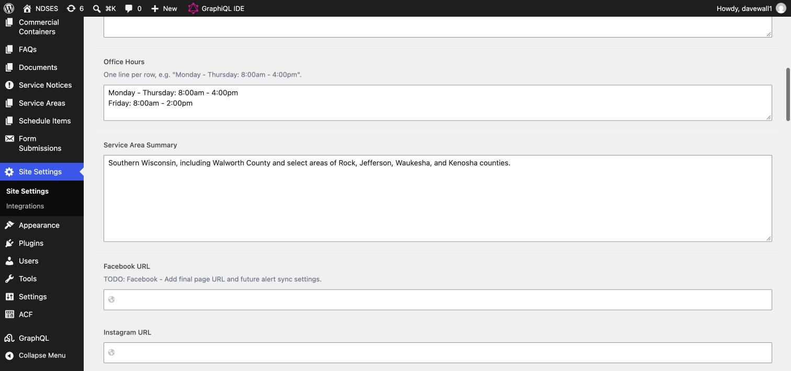

**How to update the Mission Statement or the About page story**
1. On the same **Site Settings** screen, scroll to **Mission Statement** and **About Page: Our Story**.
2. Type or paste the new text. Our Story is a rich-text box, so you can use bold, italics, and links, and press Enter to start a new paragraph.
3. Click **Save Settings**. Leaving either box empty keeps the text the site shows today.

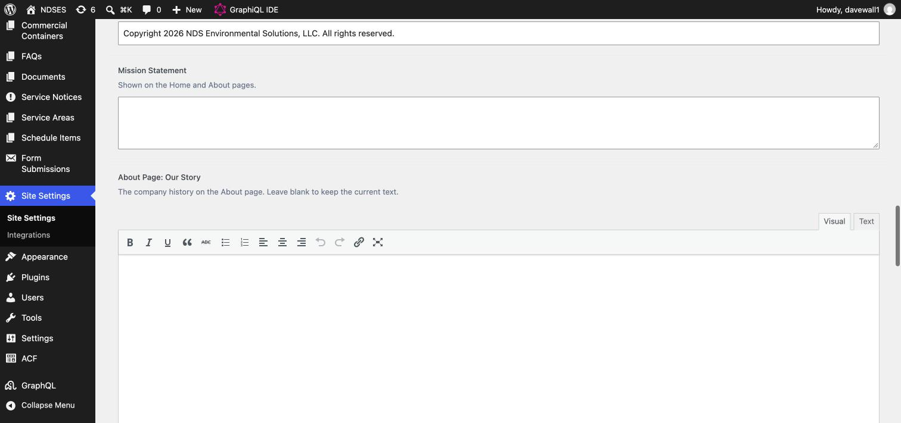

| Field | What it controls |
| --- | --- |
| Company Name / Legal Name | Displayed name vs. official registered name |
| Phone / Email | Shown in the header, footer, and contact page |
| Facility Address / Mailing Address | Contact page and footer |
| Office Hours | One line per row, e.g. "Monday - Thursday: 8:00am - 4:00pm" (press Enter between lines) |
| Service Area Summary | The one-line description of your coverage area |
| Facebook URL / Instagram URL | Powers the social icons in the footer |
| Header Logo / Footer Logo | Upload a new logo image to replace either |
| Footer Description | The short blurb under your logo in the footer |
| Copyright Text | The line at the very bottom of every page |
| Mission Statement | The "Our Mission" box on the Home and About pages |
| About Page: Our Story | The company history on the About page. Leave blank to keep the current text |

At the bottom of this screen you'll also see a few **Integration Status** fields (PayEngine Status, Form Backend Status, Google Maps Status, Facebook Alert Sync Status, Calendar Integration Status). Most of these are informational notes for your developer, not switches — changing them doesn't turn anything on or off. **PayEngine Status is the exception**: it's a real switch, and it sits next to the actual PayEngine credential fields (Public Key, API Host, Server API URL, Merchant ID) — see [Accepting Payments](#accepting-payments-payengine) before touching any of these.

## Editing Page Content

**Menu: Pages → pick a page (Home, About, Contact, etc.)**

Each main page has two boxes, top to bottom, in the same order you see them on the website:

1. **Page Hero & SEO** — the big banner at the top (eyebrow, heading, description, optional image) plus the text search engines show (SEO Title, SEO Description).
2. **[Page name] Page Sections** — one **tab per section** of the page, left to right in the order the sections appear going down the page. Each tab holds that section's eyebrow (small line above the heading), heading, text, lists, button text, and images.

Every box starts filled in with what the website shows today, so you only change what you want to change.

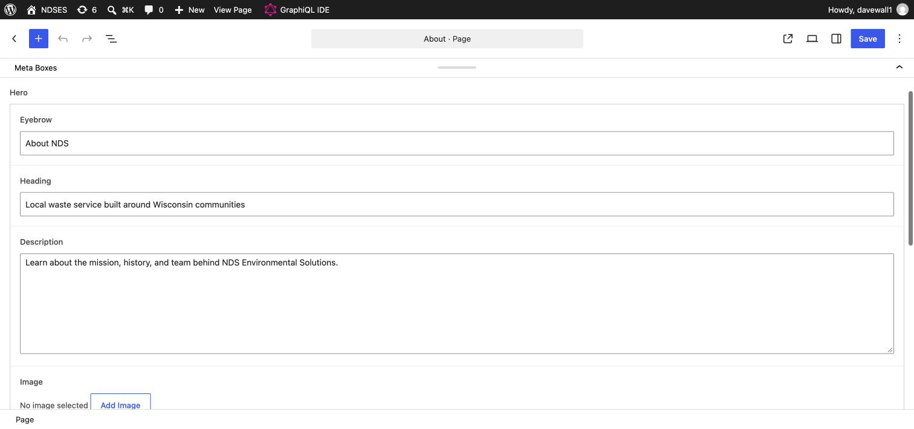

**How to update a page banner**
1. In the left menu, click **Pages**, then click the page's name (for example **About**).
2. In **Page Hero & SEO**, change the **Eyebrow**, **Heading**, or **Description**.
3. To change the picture, click **Add Image** (or the current image), choose or upload one, then click **Select**.
4. Click **Update** at the top right.

> **Home page:** the truck-by-the-lake background photo is built into the design (the green fade is lined up with where the truck sits), so the Home page's Hero **Image** box has no effect. Its eyebrow, heading, and description still work. To change the home photo, contact your developer.

**How to update a section of a page**
1. In the left menu, click **Pages**, then click the page's name.
2. In the **Page Sections** box, click the tab for the section (for example **Areas We Service** on Commercial, or **Meet The Team** on About).
3. Change the text. For lists, put **one item per line**; delete a line to remove an item, add a line to add one.
4. To change or add a picture, click **Add Image** (or the current image), choose or upload one, then click **Select**. On the About page, adding a photo to a team card shows it on that card.
5. Click **Update** at the top right.

What's in each page's tabs:

| Page | Tabs (top of page to bottom) |
|---|---|
| Home | Our Services · Why NDS · Dumpster Sizes · FAQs |
| Residential | Communities · Pickup Expectations · Accepted Recycling |
| Commercial | Areas We Service (including the county map image) · Collection Schedules · Container Options · Commercial Recycling · Industries We Serve · Quote Form |
| Dumpster Rentals | Size Guide · Materials · Rental Process · Quote Form |
| Dumpster Calculator | Recommendation Box |
| Special Events | Event Options · Quote Form |
| About | Our Story · Meet The Team (names, text, and photos) |
| Make a Payment | Payment Form · Side Box |
| Contact | Contact Box |

A few things live in their own menus instead, and each tab says so where it applies: the dumpster size cards (**Dumpster Sizes**), commercial container cards (**Commercial Containers**), FAQs (**FAQs**), community cards (**Communities**), the service area map (**Service Areas**), and the phone, email, hours, mission statement, and Our Story text (**Site Settings**). In a note, write `{phone}` where the office phone number should appear and the site fills it in from Site Settings.

**Special Events, Privacy Policy, and Terms** are ordinary pages edited the same way as any other page listed above — Special Events also has its own inquiry form (formType "event") like Commercial and Dumpster Rentals do. Privacy Policy and Terms currently hold placeholder legal text pending formal review — replace it with NDSES's actual reviewed policy before relying on it.

## Managing Communities (Residential Service Areas)

**Menu: Communities**

One entry per town/city you service (e.g. Town of Walworth, City of Delavan). Each has:

- **Service Day, Trash Schedule, Recycling Schedule** — these update the community's page and the Residential page.

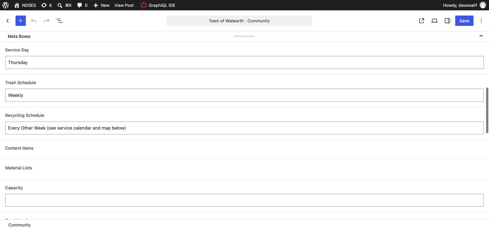

**How to change a pickup day or schedule**
1. In the left menu, click **Communities**, then click the town (for example **Town of Walworth**).
2. Change **Service Day**, **Trash Schedule**, or **Recycling Schedule**.
3. Click **Save**. Ignore the other boxes on this screen (Content Items, Material Lists, Capacity, and so on); communities don't use them.

The entry's **slug** (the part of its URL, e.g. `town-of-walworth`) must match the community's existing page address for its schedule to show. The five current communities are Town of Walworth, Town of Delavan, City of Delavan, Town of Darien, and Town of Sharon. Adding a brand-new community, or changing its recycling and bulk-item lists, is a developer change.

## Managing Dumpster Sizes

**Menu: Dumpster Sizes**

One entry per roll-off size you offer (10 Yard, 12 Yard, 15 Yard, 20 Yard, 30 Yard): Capacity (or Truck Loads), Dimensions, an Image (the dimension graphic), plus **Ideal For** and **Included** lists — type one item per line. Use the **Order** box (right-hand sidebar) to control the order sizes appear in: 1, 2, 3…

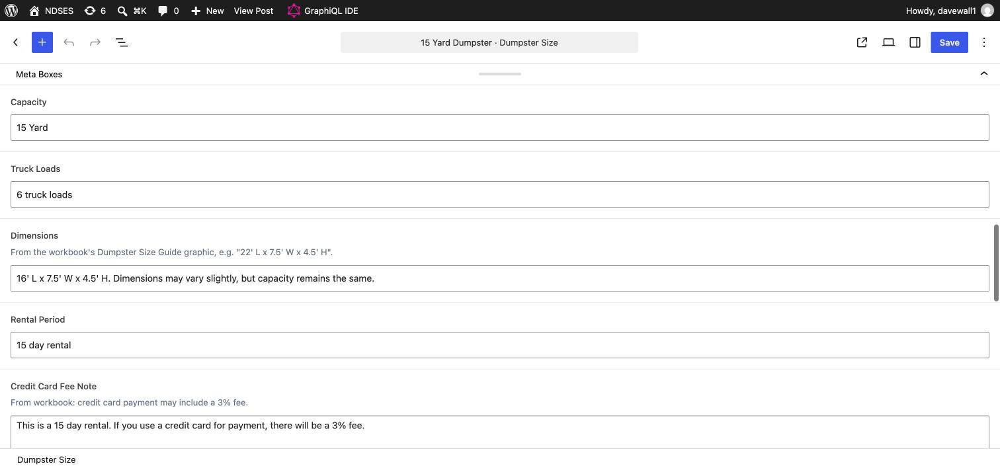

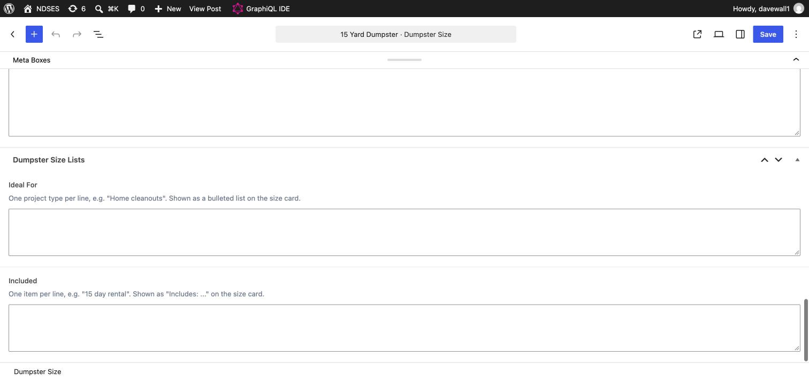

**How to update a dumpster size**
1. In the left menu, click **Dumpster Sizes**, then click the size (for example **15 Yard Dumpster**).
2. In the **Meta Boxes** panel, update **Truck Loads** (shown on the card; Capacity is used if it's blank), **Dimensions**, and **Image** (the dimension graphic).
3. Scroll to **Dumpster Size Lists**. Type the **Ideal For** projects and the **Included** items, one per line.
4. Click **Save**.

**To add a size,** click **Dumpster Sizes → Add New**, type the title (for example "12 Yard Dumpster"), fill in the same boxes, set its **Order** number, and click **Publish**.

> **Important:** the site shows exactly the sizes published here. If no sizes are published, it falls back to its built-in list. Today wp-admin still has the older **10/12 Yard Dumpster** entry. To show the separate 10 and 12 yard sizes, edit that entry into the 10 Yard (title, Truck Loads "8-10 pickup truck loads", Dimensions "11' L x 8' W x 3.5' H", 10 yard graphic), then add a new **12 Yard Dumpster** entry ("11-14 pickup truck loads", "11' L x 8' W x 4' H", 12 yard graphic).

## Managing Commercial Containers

**Menu: Commercial Containers**

The permanent dumpster options on the Commercial page (96 Gallon, 2 Yard, 4 Yard, 6 Yard, 8 Yard). Each entry has a title (e.g. "4 Yard"), Description, Dimensions, Capacity, a Dimension Graphic image, and an **Ideal For** list (one item per line). Use the **Order** box to set display order.

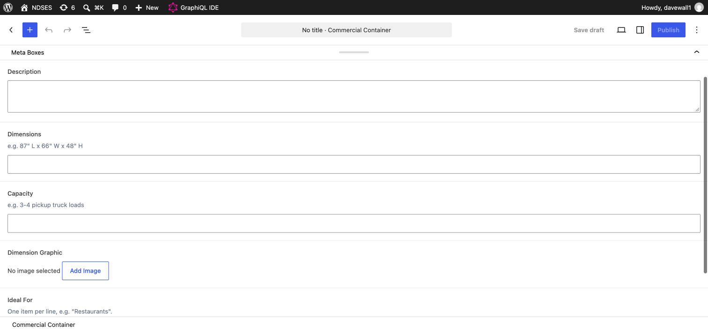

**How to add or update a container**
1. In the left menu, click **Commercial Containers**. Click **Add New** for a new one, or click an existing container to edit it.
2. Type the title, for example "4 Yard".
3. Fill in **Description**, **Dimensions** (e.g. 87" L x 66" W x 48" H), **Capacity** (e.g. 3-4 pickup truck loads), and **Ideal For** (one item per line).
4. Under **Dimension Graphic**, click **Add Image**, upload or choose the graphic, then click **Select**.
5. Set the **Order** number in the right-hand sidebar (1 shows first), then click **Publish** (or **Save** when editing).

> **Important:** no containers are entered here yet, so the Commercial page shows its built-in list (96 Gallon, 2, 4, 6, and 8 Yard). As soon as you publish one, only published containers show — enter all five before publishing, or publish them together.

**Note on the Dumpster Calculator tool** (the "recommend a size" quiz on the Dumpster Calculator page): its sizing logic is fixed in the site's code, not editable here in wp-admin. By design, checking **Other Heavy Materials** always caps the recommendation at 10 Yard regardless of project type — heavy materials (concrete, dirt, roofing tear-off) hit a dumpster's weight limit long before it's visually full, so a bigger box wouldn't help. The tool shows an explanatory note whenever that happens. If you ever want the underlying project-type-to-size mapping changed, that's a developer change, not a content edit.

## Managing FAQs

**Menu: FAQs**

Each FAQ has a Question, an Answer (rich text — you can bold, link, and add lists), a Category (**Dumpster**, **Residential**, or **Commercial**), and a Sort Order number for controlling display order within its category. FAQs appear on the FAQs page, and Dumpster/Residential FAQs also appear on the Home and Residential pages.

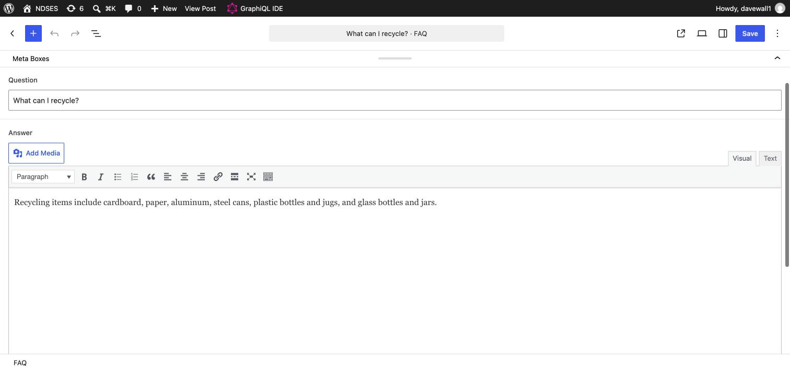

**How to add or change an FAQ**
1. In the left menu, click **FAQs**. Click **Add New**, or click a question to edit it.
2. Type the **Question** and the **Answer**.
3. Choose the **Category** (Dumpster, Residential, or Commercial) and a **Sort Order** number. Lower numbers show first within the category.
4. Click **Publish** (or **Save**).

**To remove an FAQ,** hover over it in the FAQs list and click **Trash**.

The FAQs page shows exactly the FAQs published here (21 today).

## Managing Service Areas & Schedules (the coverage map)

**Menu: Service Areas**

**Service Areas** power the coverage map shown on the Home, About, and Commercial pages. Each entry is a town or county with:
- County name
- Service Types (check any combination of **Residential**, **Commercial**, **Temporary roll-off / dumpster rentals**)
- Map X/Y Position — these are percentage coordinates (0–100) placing the dot on the schematic map. If a new entry looks off-position, nudge these numbers and refresh — ask your developer if you're not sure what to enter.

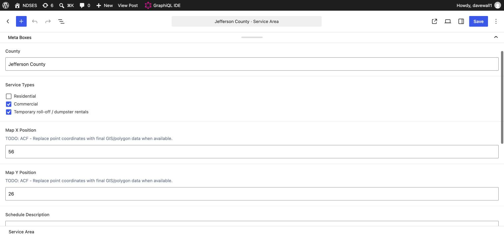

**How to add or change a service area**
1. In the left menu, click **Service Areas**. Click **Add New**, or click an area to edit it.
2. Type the title (the town or county name) and the **County**.
3. Check every **Service Type** you offer there.
4. Set **Map X Position** (0 = left edge, 100 = right edge) and **Map Y Position** (0 = top, 100 = bottom).
5. Click **Publish** (or **Save**), then check the dot on the Home page map and adjust the numbers if needed.

The map shows exactly the areas published here (9 today). Ignore the Schedule boxes on this screen.

Holiday and delay dates are communicated with [Service Notices](#posting-alerts--notices) and the community calendar downloads; the **Schedule Items** menu isn't used by the site.

## Posting Alerts & Notices

**Menu: Service Notices**

Use this for anything time-sensitive: weather delays, holiday closures, service restorations, emergency announcements. Each notice is organized into tabs at the top of the entry:

- **Notice Content** — the public title, a short summary, full details (rich text), and Internal Notes (visible only to staff in wp-admin, never shown publicly)
- **Status and Priority** — turn **Notice Enabled** on, set **Notice Status** (Draft, Scheduled, Active, Resolved, Expired), and **Notice Priority** (Informational, Standard, Important, Urgent, Emergency) — priority affects styling/prominence
- **Timing** — set Display Start / Display End dates, or turn on **Show Until Manually Resolved** if you don't know the end date yet (you'll turn it off or set Notice Status to Resolved when it's over)
- **Display Locations** — check **Site-wide announcement bar** to show it in the green bar at the top of every page. Every live notice also appears on the **What's New** page. (The other location checkboxes, Affected Communities, and Popup Settings aren't used by the site yet.)
- **Announcement Bar** — the short text shown in the top bar; if blank, the notice title is used

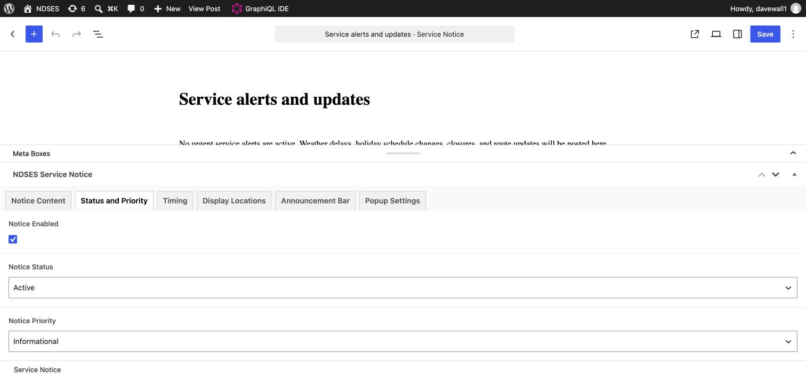

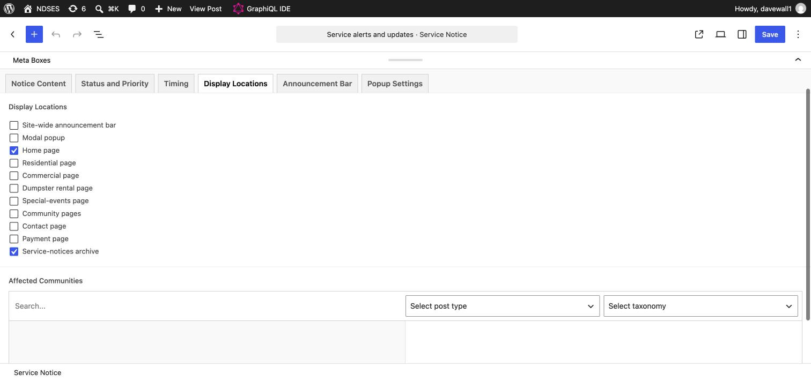

**How to post a weather delay or closure**
1. In the left menu, click **Service Notices → Add New**.
2. Type a title. On the **Notice Content** tab, add a **Short Summary** (shown on What's New).
3. On the **Status and Priority** tab, check **Notice Enabled**, set **Notice Status** to **Active**, and pick a **Notice Priority**.
4. On the **Display Locations** tab, check **Site-wide announcement bar** to show it at the top of every page.
5. Optional: on the **Announcement Bar** tab, type a shorter message for the top bar.
6. Click **Publish**.

A notice is live when **Notice Enabled** is on, **Notice Status** is **Active** (or **Scheduled** with a start date that has passed), and it's inside its Display Start/End window.

**To end a notice:** change Notice Status to Resolved (or Expired), or simply turn Notice Enabled off, then Update.

## Viewing Contact Form Submissions

**Menu: Form Submissions**

Every time someone fills out a form on the site (Contact, Commercial quote request, Dumpster Rentals request, Special Event request, etc.), two things happen automatically:

1. **You get an email** at the address set in Site Settings → Email, with the sender's info and a Reply-To set to them — you can just hit reply.
2. **It's also saved here** as a permanent record, in case an email is ever missed or lands in spam.

Click into any submission to see everything they entered — name, email, phone, service type, address, and their message — plus the Email, Phone, and Service Type columns on the list screen let you scan submissions without opening each one.

## Accepting Payments (PayEngine)

**Menu: Pages → Make a Payment**

The payment page uses a service called PayEngine to securely process credit card and bank payments — card/account numbers are entered directly into PayEngine's secure fields and never touch this website or its database.

**Two places hold PayEngine credentials, both treat their values like passwords — don't share or paste them anywhere else:**

1. **Pages → Make a Payment → edit → right-hand Settings panel → PayEngine Secret Key.**
2. **Site Settings → PayEngine Public Key, PayEngine API Host, PayEngine Server API URL, PayEngine Merchant ID.** (Site Settings also has the **PayEngine Status** dropdown — Test mode / Live.)

**To switch the site from test to real, live payments:**
1. Log in to your actual PayEngine dashboard (not this site) and find your **live-mode** keys under API Keys — they start with `pk_live_` and `sk_live_`, not `pk_test_`/`sk_test_`.
2. Paste the live secret key into the Make a Payment page's Secret Key field (above) and Update.
3. Paste the live public key, API host, server API URL, and merchant ID into the four Site Settings fields above and Update. PayEngine's dashboard will tell you the correct host/API URL for live mode if they differ from sandbox.
4. Only after both of those are saved, set **PayEngine Status** to **Live** and Update.

Until step 4, the site keeps working exactly as before — nothing changes just from filling in the fields. Once "Live" is set with real `pk_live_`/`sk_live_` keys, real customer cards will be charged, so double-check everything before that last step. If anything's unclear, contact your developer rather than guessing.

## Common Questions

**I published a change but don't see it on the live site.**
Give it about 5 minutes — content is cached briefly for speed. If it still hasn't appeared after that, try a hard refresh (Cmd+Shift+R / Ctrl+Shift+R), and if it's still missing, contact your developer.

**How do I add a new FAQ?**
Create it under the FAQs menu with the right Category and publish. It appears on the FAQs page automatically (see the note in [Managing FAQs](#managing-faqs) about the built-in FAQs).

**How do I post a weather delay or closure notice?**
See [Posting Alerts & Notices](#posting-alerts--notices) above — that's the Service Notices menu.

**Someone submitted the contact form — where do I see what they wrote?**
Check your email first (it's sent automatically), or open **Form Submissions** in the left menu — see [above](#viewing-contact-form-submissions).

**Can I change our phone number, hours, or address myself?**
Yes — Site Settings, no developer needed.

**I forgot my password.**
Use the "Lost your password?" link on the wp-admin login screen.

**Can I edit the PayEngine secret key or payment settings?**
You can, but shouldn't unless your developer walks you through it — see [Accepting Payments](#accepting-payments-payengine).

**Do I need to touch the "Integration Status" fields in Site Settings?**
No — those are informational notes for developers, not real switches.

## Who to Contact

For anything beyond day-to-day content edits — new page types, design changes, payment/PayEngine configuration, technical errors, or account access — contact Abby Lehr at **abby.lehr@radicalsurfaces.com**.
